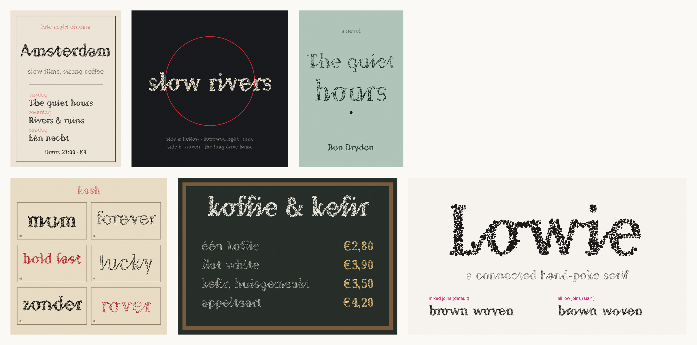

# Lowie

A connected serif drawn as hand-poke tattoo dots. Every letter joins the next.

Free and open source under the [SIL Open Font License 1.1](OFL.txt): use it for anything, personal or commercial, and modify it. The one thing you can't do is sell the font files on their own.



## Styles

- **Poke**: irregular hand-poke dots in mixed sizes, some oval or doubled, with a ragged edge.
- **Poke Shaded**: a dense edge, lighter shading inside.
- **Poke Line**: the outline only.

## Joins

Joins happen by themselves as you type. b, o, r, v and w hand over along the top, as in handwriting; the rest join from the foot. To make every letter join from the foot, turn on stylistic set 1, "All low joins":

- Figma: Type details > Stylistic sets
- CSS: `font-feature-settings: "ss01";`

Capitals join into the lowercase letter after them, never to each other.

## Install

- Mac: double-click a `.ttf` file in `fonts/` and choose Install.
- Windows: right-click a `.ttf` file and choose Install.
- Web: use the `.woff2` files.

```css
@font-face {
  font-family: "Lowie";
  src: url("Lowie-Poke.woff2") format("woff2");
}
```

Lowie has one weight. On headings set `font-weight: 400; font-synthesis: none;`, or the browser fakes a bold and the dots merge.

## Good to know

- Lowie is a display font. Use it at 30px and above; below that the dots merge into grey.
- Files are large (0.8 to 1.7 MB per style as WOFF2), because every dot is its own shape. Fine for headings and print, heavy for body text on a website.

## Characters

a to z, A to Z, accented letters for Dutch, French, German, Spanish and Portuguese, 0 to 9, punctuation and common symbols. Not yet: { } § ¢ ¥, fractions, Polish, Czech and other Central European letters.

## Source

The fonts are built from code in `source/` (Python, fontTools, skia-pathops). See [FONTLOG.txt](FONTLOG.txt) for the history.

Copyright 2026 Ben Dryden.
